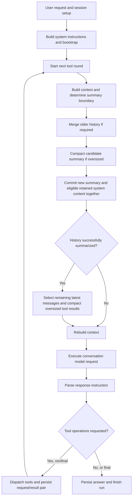

# AI Assistant processing and context lifecycle

This is the control-flow guide for the FlowBlox AI Assistant. It explains how a user
request becomes model messages and tool operations, and how the conversation stays
usable as it grows. Configuration changes the limits; the processing phases below
remain the same.

## Main responsibilities

| Component | Responsibility |
| --- | --- |
| [AiAssistantService](AiAssistantService.cs) | Coordinates runs, rounds, history, summary updates, tool dispatch, run control, usage, and diagnostics. |
| [AssistantPromptBuilder](../Builder/AssistantPromptBuilder.cs) | Builds system instructions, session bootstrap, initial user prompts, and tool-response transcripts. |
| [AssistantChatRequestBuilder](../Builder/AssistantChatRequestBuilder.cs) | Selects recent history and renders it for the selected provider, including native tool-call history. |
| [AiProviderExecutor](AiProviderExecutor.cs) | Applies provider/model settings and executes an already prepared request. |
| [DefaultToolApi](../Tools/DefaultToolApi.cs) | Resolves requested tool names, applies execution policies, and invokes handlers. |
| [Compaction orchestration](AiAssistantService.Compaction.cs) | Runs the shared bounded compaction operation and the separate post-summary tool-result pass. |

## Runs and tool rounds

A run starts with `ExecutePromptAsync` for a user request and uses the current
session, or creates one. A session can span several user requests and be saved and
restored. A run can contain several model/tool rounds:

The first round sends the formatted initial user prompt. Later rounds send a short
continuation prompt; the original user request and completed tool operations are
already in history. Bootstrap/system content is supplied on each request rather
than stored repeatedly as conversation entries.

`MaxToolRounds` bounds conversation-model iterations, not the number of individual
tool calls. Several calls, including a batch, can be handled in one round. The final
answer and response-format retries also consume conversation rounds. Summary and
compaction requests are separate model requests and do not consume additional tool
rounds. Reaching the round limit without a final response ends the run with an error.
The default round limit is 100.

## Initial instructions, bootstrap, and explanations

The service builds the main system instruction and a session bootstrap from the
[prompt catalog](AssistantPromptCatalog.cs) and embedded prompt templates. The
bootstrap contains the tool catalog, bootstrap contracts, workflow rules, type-alias guidance, and
routing information for additional explanations. Explanations designated as initial
guidance are included directly in that bootstrap; they do not need a tool round to
load them.

Tool contracts follow the same split: regular discovery, type inspection, snapshots,
FlowBlock/managed-object/field editing, connections, and basic project debugging are
included in full. They can be called directly without `GetToolDefinitions`.
Specialized operations (Skills, distributed data, input files, options, generators,
test definitions, and toolbox templates) are listed separately with short purposes;
load their contracts only when needed. A tool appears in exactly one group, as
declared by `ToolPurpose.IncludeContractInBootstrap`. Explanation routing likewise
lists only explanations that are not already included in the bootstrap.

Handlers and explanation declarations have an AssistantScope: All (the default),
Component, or Project. Scope is evaluated before initial/on-demand classification.
Inapplicable tools and explanations are absent from the current catalog; direct
and batch tool calls enforce the same scope. LoadExplanation also rejects keys
outside the active scope. Initial component guidance is declared with Component
scope and IsIncludedInInitialPrompt=true and is included by the normal bootstrap
builder, without a special preload path.

Skill guidance is split by operation: `explaining_skills` covers discovery in
Distributed Data or the session, parameter contracts, execution, and output inspection
in both scopes. `explaining_skill_project_editing` covers creation, intentional
adaptation, and the edit/debug/save lifecycle, and is available only in project scope.
Component mode retains Distributed Data discovery/reading and existing-Skill execution;
it does not expose Skill creation/editing or project-debugging instructions.

Component mode permits the current working copy, its reactive configuration and
owned managed objects, including result fields and TestDefinitions. General
managed objects, skill creation/editing, project debugging and Project Space
search are excluded. Existing skills remain inspectable and executable through
ExecuteExternalProject. TestDefinitions and generators may be configured;
RunGenerationStrategies remains restricted to the current FlowBlock. Incoming
ReferencedFlowBlocks may be changed, but outgoing connections and foreign
FlowBlock configuration remain protected. The component prompt requires a brief
user-facing explanation when a requested capability is unavailable.

`LoadExplanation` uses [Verbatim Context Retention](#verbatim-context-retention)
for on-demand guidance, through the same mechanism as static tool and type descriptions.

The initial user prompt includes the user's text, current editing/skill context,
and information about whether a project or component snapshot is attached. Snapshot
attachment depends on configuration and the known snapshot hash. It is not an
unconditional full-project attachment on every request.

## Tool catalog and on-demand contracts

The bootstrap dynamically lists each scope-available tool by name and short purpose.
The purpose lives on the handler's `ToolPurpose` annotation. Only `GetToolDefinitions`,
`LoadExplanation`, and `BatchExecuteToolRequests` include their full contracts in
the bootstrap so discovery, guidance loading, and batching work immediately.

`GetToolDefinitions(toolNames=[...])` retrieves one or several full contracts from
the same definitions previously rendered in the bootstrap: descriptions and argument
schemas are returned without shortening or rewriting. It applies the same current-scope
filter and tool-name resolution as dispatch. A request containing an unavailable name
fails before registering any partial result. Unknown names return the available names.

Before executing a non-bootstrap tool during an Assistant run, dispatch checks that
its contract is present in the context actually shown to the model: either selected
history or retained system content. This also applies to batch children and runs before
approval or side effects. Loading a definition and guessing its call in the same model
response is rejected; the model must read the result in the following round. Direct
programmatic Tool API calls outside Assistant execution retain their existing behavior.

Contracts use [Verbatim Context Retention](#verbatim-context-retention).
A contract outside the selected history without a retained system entry is fetched
in full again. New handlers must provide a short purpose annotation and their complete
`Definition`; mark a contract for bootstrap inclusion only when needed to bootstrap discovery.

## Message layout and history representation

Each conversation request is assembled in this order:

1. Main system instruction.
2. Session bootstrap, including applicable initial scope guidance.
3. One append-only sequence of retained explanations, type schemas, and tool contracts, in promotion order.
4. Conversation summary, if present.
5. Selected recent history entries.
6. Current initial-user or continuation prompt, including pending format feedback.

The persisted conversation has single user/assistant messages and
`AssistantMessagePair` entries. A pair stores the normalized assistant tool-request
instruction, its tool-response transcript, and provider-specific metadata. One pair
can contain several tool calls and results. Selection limits count persisted entries,
so one pair can expand into multiple model-side blocks.

For providers supporting native function-call history, a pair becomes an assistant
message with function calls and a tool message with associated function results. IDs
are generated consistently from the history-entry and call positions. Providers
translate these semantic messages into their native wire format. Other providers
receive the corresponding assistant/tool text representation.

The summary is represented as a user-compatible semantic message before recent
history. It is historical context rather than a new system instruction. The current
round prompt is appended once; on the first round it is then persisted for future
requests.

## Model responses and local tool dispatch

The model returns the structured response contract: assistant text, a final flag,
and requested tool calls. The response parser normalizes supported formats and can
use provider-specific parsing for compatible alternate output.

When a nonfinal tool instruction has an empty `assistantMessage`,
[AssistantActivityFormatter](AssistantActivityFormatter.cs) supplies a localized
description of its planned activities, including individual requests inside batches.
The service uses that text in the transcript and normalized history; provided model
text and the actual tool requests are preserved. This requires no additional model
request. Original model JSON remains available in the communication protocol when enabled.

- A final instruction, or an instruction without tool calls, completes the run.
- A nonfinal instruction with calls is dispatched locally through `DefaultToolApi`.
  Tools are not executed simply because they appear in historical native function
  messages; only the current parsed instruction initiates operations.
- Tool responses record success, results, errors, and logs. A tool failure is recorded
  as feedback for the next model round; it does not by itself force the whole run to
  end. Handler execution/approval policies still apply.
- Completed calls are serialized into a tool transcript and persisted with the
  normalized assistant request as one pair before the next round.
- An invalid instruction is recorded and receives one corrective format-feedback
  attempt on the next round. Another consecutive invalid response ends the run.
  Provider execution failures end the current run directly.

The principal handlers relevant to this lifecycle are:

| Handler | Effect on the conversation |
| --- | --- |
| `LoadExplanation` | Adds on-demand system guidance for subsequent requests. |
| `GetToolDefinitions` | Loads complete tool contracts using Verbatim Context Retention. |
| `GetTypeKindsInfo` / `GetManagedObjectKindsInfo` | Return type metadata, or refer to metadata already available in the active context; successful full responses carry retention tags. |
| `GetProjectJson` / `GetComponentSnapshot` | Supply current state when the model needs inspection or verification. |
| `BatchExecuteToolRequests` | Groups handler operations while preserving each result and its retention metadata, including successful results from a partially failed batch. |

Other discovery, editing, execution, and debugging handlers use the same request /
response loop. Their domain-specific details are outside this guide.

## Selecting recent history and summarizing older entries

The context budget counts complete input size, including cached system content, and
reserves response capacity. Provider/model limits and measured usage can refine the
estimate. Cache discounts affect cost, not how much context the model can accept.
The default total budget is 64000 tokens, including the response reserve. With the
default 4096-token response reserve, up to 59904 input tokens remain, subject to the
selected model's limits. System, summary, history, and current-prompt tokens all count.

The request builder selects a contiguous recent window after the successful summary
checkpoint. `MaxLatestMessages` caps the number of entries; the available token
budget can reduce it. `MinLatestMessages` protects the newest entries even when their
estimated size exceeds the remaining budget. Defaults are 20 maximum and 2 minimum.
Retention never removes entries or rewrites their payloads. Existing history selection
and `MinLatestMessages` continue to determine which original entries remain active.

If selection leaves unsummarized entries behind, the service calculates a summary
target using the excluded range and `SummaryCompactionRate`. It merges the existing
summary with original messages in that range. Only a successful, nonempty response
advances `SummarizedMessageCount`. Failure, empty output, or cancellation does not
commit the proposed boundary. Summary input uses the
[Verbatim Context Retention](#verbatim-context-retention) availability inventory. It
instructs the summarizer to treat matching references as available content and correct
obsolete missing-schema/blocker claims in the existing memory. Original history entries
remain stored with unchanged roles, content, and tool-call associations.

The main conversation request is rebuilt after this work. The service also retries
necessary summary work when completing a run; a successful merge there uses the same
post-summary processing. It does not invent an additional conversation/tool round.

## Prefix-preserving context maintenance

`AssistantChatRequestBuilder.BuildMaintenancePrefix` uses the same system/summary/history
renderer as ordinary requests, through the existing absolute history indexes. It includes
the old system messages and memory, followed by the older unsummarized range; protected
latest entries stay outside that range. No additional persistent request snapshot is needed.

`AssistantMaintenanceRequestBuilder` appends the existing summary instructions and retention
inventory at the end, without modifying the shared prefix. A stable maintenance exception
in the main system prompt permits Markdown for these internal operations while ordinary
Assistant requests retain their JSON contract. Maintenance never dispatches tool calls.
If a history result was previously compacted, its original source is appended as additional
summary input so prefix reuse does not sacrifice the original technical information.

A required summary compaction can continue that branch with the generated summary and
the existing compaction instructions. Prior requests are not mutated when adding their
responses. Tool-result compaction stays targeted and uses the same compaction engine.
Both operations remain conditional, with the existing one-attempt-plus-one-retry bound.

Each shared-prefix request must fit the input budget including response reserve. The
existing pricing calculator also compares its optimistic cache-read input cost with the
targeted request, including supported pricing tiers. If the shared request cannot fit or
is already more expensive even with cache hits, the targeted request is used. With unknown
pricing, a fitting shared prefix is preferred. This estimates input cost; it does not
guarantee a cache hit or include unknown cache-write charges. Provider usage remains authoritative.

The candidate summary, its checkpoint, and eligible retained contents are committed in
one locked transition only after summary/summary-compaction processing completes. Until
then auxiliary requests use the previous system prefix. Cancellation publishes none of
the staged summary or retention changes. A failed/empty summary does not advance its
checkpoint or promote pending content unless a separate successful summary compaction
changes the existing context. Original history and tool IDs stay intact.

## Separate summarization, retention, and compaction operations

| Operation | Trigger | Input and resulting change |
| --- | --- | --- |
| History summarization | Older entries no longer fit the selected recent window. | Merge original older history into the running memory and advance the checkpoint on success. |
| Verbatim Context Retention | A successful summary or summary-compaction context transition. | Copy eligible payloads into ordered system messages while preserving history; see the dedicated topic below. |
| Summary compaction | Existing memory exceeds `MaxSummaryTokens` (default 10000). | Shorten only that existing summary; do not consume additional history or move the checkpoint. |
| Tool-result compaction | A history summary merge has just succeeded. | Independently examine remaining latest messages and condense each tool result strictly exceeding `ToolResultCompactionThreshold` (default 4000 tokens). |

Tool-result compaction is a separate orchestration step reacting to successful
summarization, not an operation performed on every tool response or every round.
It runs after summary maintenance and the bundled retention transition, before the
rebuilt conversation request. A marker-based guard also excludes pending retained
results and any retained-content references that remain in mixed results.
Merely restoring a summary or compacting an oversized existing summary does not
trigger it.

Both compaction kinds reuse the same request builder and bounded execution routine:
one attempt and at most one corrective retry. The shared target ratio defaults to
0.5 of the relevant threshold. Only shorter, nonempty successful candidates are used;
there is no hard string truncation to enforce a target. A failed attempt leaves the
original or the best shorter candidate available. Technical completeness takes
priority over reaching the target exactly.

For tool results specifically:

- Never compact a result marked for Verbatim Context Retention, including a mixed batch
  containing protected content or its retained-content reference.
- Inspect other results separately, including multiple results in one message pair.
  A large aggregate does not cause small individual results to be compacted.
- Preserve original `AssistantRequest`, `ToolApiResponse`, and `CompleteMessage`.
  Store context-only replacements in `CompactedToolResults`, keyed by result position.
- Render replacements as explicitly marked compacted results in both text and native
  histories. Preserve roles, function names/arguments, call IDs, and associations.
- Keep structured status, error, and log fields verbatim when present at the result's
  top level. The compaction instruction also requires relevant execution outcomes,
  exact technical identifiers, error details, and ongoing debugging information.
- Do not compact ordinary user or assistant messages or the assistant side of a pair.
- Rebuild selection using the smaller projections. If more recent unsummarized
  entries now fit, inspect those too without pulling summarized entries back in.
- Persist projections alongside the originals and reuse them in later requests and
  after restore. Further changes are allowed only during another successful-summary
  pass, which rechecks the active result against the threshold.

## Verbatim Context Retention

**Verbatim Context Retention** is the shared token-protection mechanism for reusable,
static tool content. Repeated retrieval is treated as a signal that the summary or
selected history did not preserve enough usable detail. Retaining the full content
in system messages avoids further retrieval attempts and repeated processing of the
same descriptions. Explanations use the same mechanism proactively.

### Explanations: proactive retention on the first retrieval

`LoadExplanation` guidance qualifies on its first successful retrieval. The complete
guidance is immediately available in its tool result and copied into system messages
at the next successful context transition.
Explanations included in the initial bootstrap already reside in the static prefix.

### Type descriptions: retention on the second retrieval

`GetTypeKindsInfo` and `GetManagedObjectKindsInfo` share a retention key for the same
type. The first payload remains in history; the second retrieval qualifies its exact
content for system retention. Type properties, enums, and nested metadata stay intact.

### Tool API descriptions: retention on the second retrieval

Each contract returned by `GetToolDefinitions` is counted separately by canonical
tool name. The first retrieval stays in history, and the second qualifies the complete
description and argument schema for system retention. A successful summary alone
does not promote a once-requested contract.

### Shared implementation and lifecycle

All three cases use `AssistantRetainedContent`, `ToolHandlerUtilities` retention
registration/location lookup, and `AssistantHistoryRetention.Promote`. There is no
separate tool-catalog cache or promotion path. The single policy requires one retrieval
for `Explanation` and two for other retained content, including `TypeInfo` and
`ToolDefinition`. Only successful retrievals register markers; duplicate names within
one discovery request count once. Repeated requests in the same round or batch count
as separate retrievals.

Markers persist the key, exact content, kind, and result position. A repeat references
the preserved payload in current history or system messages instead of duplicating it.
Both pending payloads and retained content are protected from compaction.

`GetPendingPromotions` previews this same policy across the complete history, including
retrievals in the latest messages. The authoritative summary inventory includes existing
system content and pending promotions. Original payloads remain in summary input to
preserve prefix identity; the summarizer must omit duplicated static descriptions from
its output while keeping task-specific facts, decisions, errors, and diagnostics.

Eligibility is distinct from publication: eligible content is copied only at the
[bundled context transition](#prefix-preserving-context-maintenance), in event order
without regrouping by kind. In the meantime it remains available in tool history.
Location checks consider actually selected history and retained system content; if a
pending payload has left the active window, retrieval returns it in full again.
Guidance and tool contracts bypass generic type-alias string rewriting, preserving
their exact tested content in history as well as in retained system messages.

No message or payload is extracted from original history. A retained description can
temporarily appear in both system messages and selected history. This deliberately
accepts duplicate context tokens in exchange for stable history and call IDs. Normal
history selection eventually excludes older entries; no retention-specific index repair
or payload replacement is needed, including inside mixed or partially failed batches.

The history document saves that ordered list as well as remaining pending markers;
restore clones both and reconstructs the same content and retrieval counts.
Legacy `RetainOnSummarization` markers remain readable. Restoring local retained content
does not preserve the remote provider's cache lifetime.
Ordinary tool-result compaction still preserves its original transcript plus a
context-only projection; it does not rewrite original history.

Provider-specific cache activation and breakpoint placement are described in the
[provider caching guide](../../FlowBlox.Core/Models/FlowBlocks/AIRemote/Providers/README.md).

## Run control and diagnostics

Pause requests take effect at round boundaries; completed model/tool operations are
preserved. Staged user messages are drained into history before the next request,
including messages received while summary/compaction work is running. Stop uses
cancellation. Optional automatic layout adjustment follows layout-relevant edits at
pause/completion boundaries.

Model, summary, and compaction requests share usage/cost tracking, communication
status, and optional protocol logging. Auxiliary requests contribute to session cost
but do not replace the reported context size of the working conversation request.
Debug/history views retain original messages; context projections determine what is
actually sent. Tests for these flows live in `FlowBloxTest/AIAssistant`, particularly
the service-context, summary-compaction, tool-result-compaction, retention, and
Anthropic serialized-request tests.
