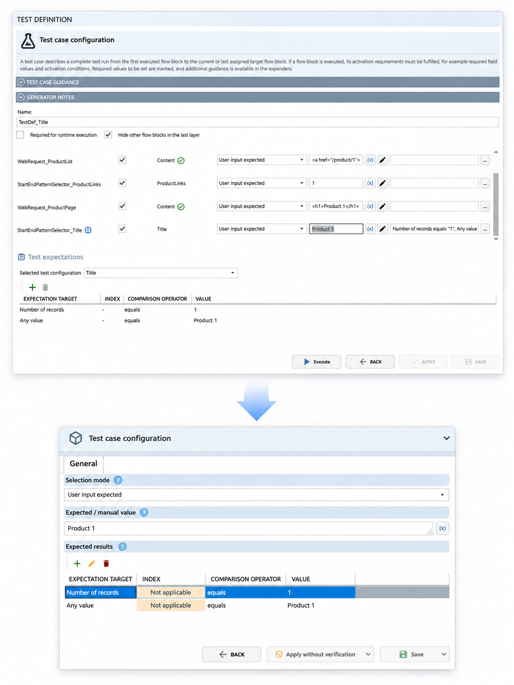
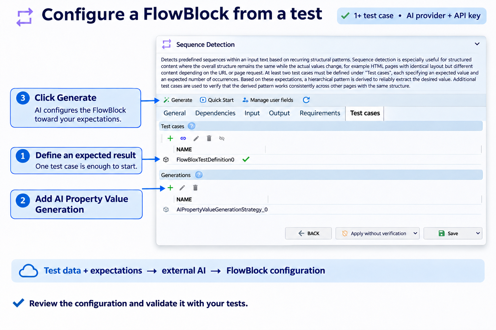
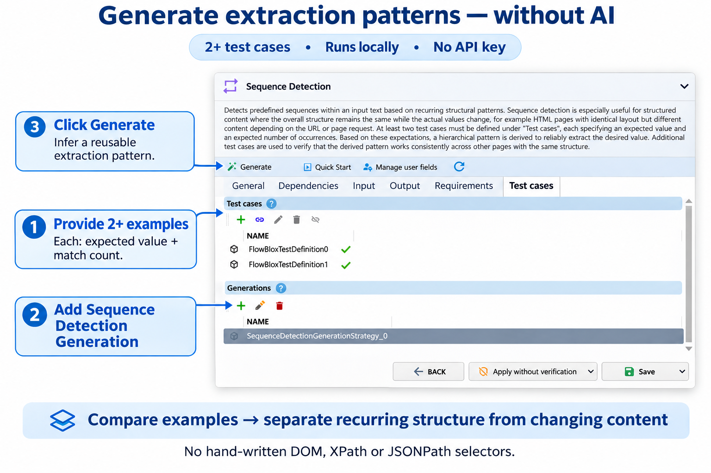
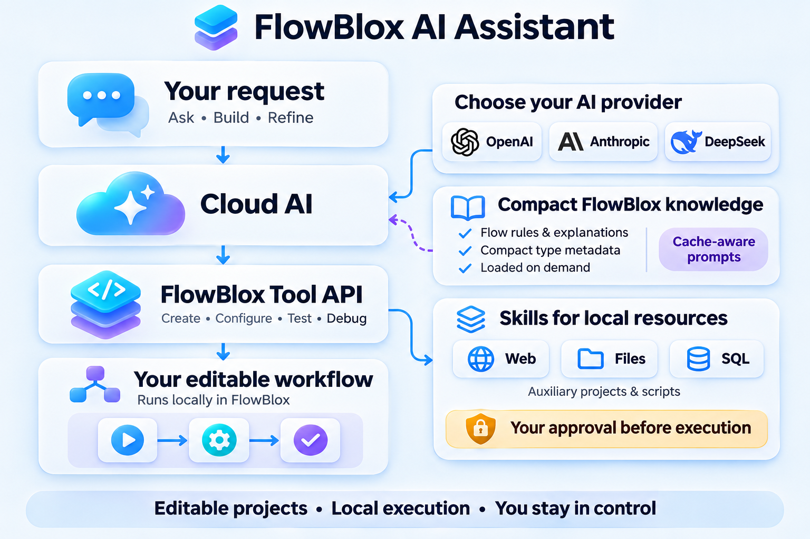

# FlowBlox

### AI Builds It. You Own It.

**Open-source, local-first visual automation — with AI-generated workflows you can inspect, edit, test, and run yourself.**

FlowBlox turns real-world data-processing problems into reusable automation projects. Build workflows visually from existing FlowBlocks, or describe your task to the integrated AI Assistant and let it create or extend a **fully editable FlowBlox project**. Run locally without setting up a server, and automate execution through the desktop application, CLI, operating-system task scheduler, or a service.

**Windows x64 · MIT licensed · .NET-based · Local-first**

[**Get started**](#quick-start) · [**Watch overview**](#video-overview) · [**See examples**](#example-projects) · [**Contribute**](#contributing)

## Quick start

### Install

<!-- TODO: Confirm that a public Windows x64 MSI release is available and update this step with the verified download URL. -->
1. Download the Windows x64 MSI from the project's download page: **[FlowBlox website](https://flowblox.net/)**.
2. Install the MSI package. The installer includes required ONNX runtime packages.
3. Start FlowBlox.
4. Explore bundled sample projects through **Open example project**.

### Create your first workflow

1. Drag a **Start** FlowBlock from the component library onto the project grid.
2. Add and connect additional FlowBlocks.
3. Configure their properties and required fields.
4. Run the flow and inspect its results.
5. Optionally choose **FlowBlox App → Edit → Automatically align flow**.

## Contents

- [Quick start](#quick-start)
- [Video overview](#video-overview)
- [Why FlowBlox?](#why-flowblox)
- [See FlowBlox in action](#see-flowblox-in-action)
- [How FlowBlocks work](#how-flowblocks-work)
- [How the FlowBlox AI Assistant works](#how-the-flowblox-ai-assistant-works)
- [Testing and generators](#testing-and-generators)
- [Running and deploying workflows](#running-and-deploying-workflows)
- [Example projects](#example-projects)
- [Local AI and ONNX](#local-ai-and-onnx)
- [Platform support and building](#platform-support-and-building)
- [Next development milestones](#next-development-milestones)
- [Contributing](#contributing)
- [License](#license)

## Video overview

<!-- TODO: Replace VIDEO_ID with the published FlowBlox overview video ID and add its thumbnail at docs/images/youtube-overview.png. -->

## Why FlowBlox?

- **Start locally, without infrastructure.** Install the Windows desktop application and build workflows without provisioning a server or Docker environment. Connections to external systems and cloud AI providers still require their respective credentials or services.
- **AI-generated, human-editable workflows.** The AI Assistant can create new projects, continue existing ones, configure FlowBlocks, test results, and explain the application. Its output remains a regular visual project, not an opaque one-off agent action.
- **AI that can build reusable tools.** The assistant can use existing Auxiliary Projects as skills and assemble new auxiliary flows from available FlowBlocks when it needs additional capabilities.
- **Work with local resources.** Automate tasks involving files, local databases, intranet websites, and other resources accessible to the FlowBlox process and its configured credentials.
- **Generate from examples.** Define expected results in test cases, then use AI-based or offline generators to derive selectors, patterns, and FlowBlock configuration.
- **Test before execution.** Required generator tests can be validated before runtime proceeds; failing tests can trigger regeneration and prevent execution if validation still fails.
- **Extend the platform.** Build your own FlowBlocks, share extensions, Auxiliary Projects, or complete example projects.

## See FlowBlox in action

### Build and refine workflows with AI

Describe a task in plain language, ask the assistant to modify an existing project, or discuss a concept before implementation. The assistant can work with the same application features available to a user; generated projects remain inspectable and editable in the visual editor.

### Design and inspect workflows visually

Compose reusable FlowBlocks on a project grid, connect operations, configure properties, and inspect execution results. Use the editor to refine both manually created and AI-generated projects.

### Define expected results and test them

Attach test cases and expectation conditions to FlowBlocks. Supply predecessor values manually or select them automatically to validate extraction and transformation behavior.

### Generate extraction logic from examples

Generators automate configuration that would otherwise need to be written by hand, such as extraction patterns or FlowBlock property values. Instead of starting with a selector or pattern, provide **example input data and expected results in test cases**. A generation strategy uses these examples to derive configuration; the same tests then let you validate and refine the result.

Open a FlowBlock's **Test cases** tab, define its tests, and add a strategy under **Generations**. Click **Generate** to apply the selected approach. The two strategies below address different configuration needs.

#### AI Property Value Generation

Start with **at least one test case** and select an **AI provider with an API key** for the generation strategy. For supported result-producing FlowBlocks, `AIPropertyValueGenerationStrategy` uses the test data, expected results, and property context to configure the block toward those expectations, for example by generating an extraction pattern.

Add **AI Property Value Generation** under **Generations**, then click **Generate**. Relevant input and configuration data are sent to the external AI provider. Review the generated configuration and validate it with your tests.

View AI Property Value Generation example

#### Sequence Detection Generation

Provide **at least two test cases** with similarly structured input content, an expected value, and an expected match count for each. Comparing the examples separates recurring structure, such as HTML tags or JSON syntax, from changing content and derives a reusable extraction pattern. No hand-written DOM, XPath, or JSONPath selectors are required.

Add **Sequence Detection Generation** under **Generations**, then click **Generate**. `SequenceDetectionGenerationStrategy` runs **locally, without AI**: no AI provider or API key is needed.

View Sequence Detection Generation example

## How FlowBlocks work

Build a workflow by connecting **FlowBlocks**, configuring their inputs and outputs, and defining how data moves between them. The local runtime executes the project using built-in or extension FlowBlocks and the resources available through your configured connections and permissions.

FlowBlocks perform operations such as reading data, extracting values, transforming content, and writing output. Result datasets carry field values to connected successors.

For multiple inputs, the iteration context coordinates each processing cycle and the input behaviors determine how values are combined. The target runs after the input paths complete the **current iteration**, before the next iteration begins.

See the [FlowBlocks and execution guide](docs/flowblocks.md) for dataset propagation, block variants, input combinations, iteration context, and flow design patterns.

### Example: find Word documents missing a required code

Suppose Word documents are stored as BLOBs in a SQL database. You need to identify documents within a date range that do not contain a required printed code.

1. Create a FlowBlox project and configure an SQL table/command for the relevant date range.
2. Use a `TableReader` to iterate the returned datasets and obtain each document BLOB.
3. Convert the Word/OpenXML content to text with `OpenXMLToText`.
4. Check the extracted text for the required code using a regular expression.
5. Collect or export the affected document records and optionally schedule the workflow.

This approach also applies to structured website extraction, including internal sites such as Jira or Confluence where access is available.

## How the FlowBlox AI Assistant works

The AI Assistant translates a natural-language request into a **normal, editable FlowBlox project**. A cloud AI reasons about the task using compact FlowBlox knowledge and calls the **FlowBlox Tool API** to create, configure, test, and debug the workflow. FlowBlox carries out those operations locally; the resulting project remains available for you to inspect and edit.

Flow rules, type metadata, and explanations provide application-specific knowledge. Additional explanations are loaded on demand, and reusable context is prepared for provider prompt caching where supported. Compact context and caching reduce repeated input overhead.

### What the assistant can do

The integrated AI Assistant can:

- Create complete FlowBlox projects from natural-language requests.
- Modify and extend the current project instead of starting from scratch.
- Explore available application functions, data sources, and existing FlowBlocks.
- Configure, run, test, debug, and revise workflows.
- Answer questions about the interface and application features.
- Discuss a solution concept before creating the implementation.
- Use bundled Auxiliary Projects as skills and create additional auxiliary flows from FlowBlocks.

**Cloud provider integrations include:** OpenAI, Anthropic, DeepSeek, and Kimi. Cloud model use is optional for manually built workflows and offline-capable features, but requires access to the chosen provider when enabled.

### Start with a request

Open the AI Assistant in the right-hand panel. Use its **gear icon** to open Configuration, add an AI provider, choose a model, and enter an API key. Then describe your task, for example:

> Create a flow that executes an SQL query, iterates through the returned rows, reads JSON property `XZ`, keeps rows where the value equals `XY`, and exports the results to CSV.

### Example: describe the document check

For the Word-document workflow described above, ask the assistant to inspect the available database structure, build the project, test it, and report documents missing the required code. It can use Auxiliary Projects as skills to retrieve the information it needs, then assemble the final editable workflow.

### Local access and execution approval

The assistant can use FlowBlox capabilities to work with accessible local files, databases, and intranet systems. Its access is constrained by the application's environment, configured connections, and operating-system permissions.

**AI-initiated script execution (including PowerShell/Python) and execution of Auxiliary Projects require your approval.** Previously approved Auxiliary Projects can run under a remembered approval. Requests and relevant project or tool data are sent to the selected cloud provider.

## Testing and generators

Define expected values and dataset counts in test cases, then validate the configured flow. Generators can derive configuration from those examples; tests marked as required for runtime execution can trigger regeneration and stop execution if validation still fails.

See the [testing and generators guide](docs/testing-and-generators.md) for test setup, strategy types, and the runtime validation sequence.

## Running and deploying workflows

FlowBlox projects can be executed through the desktop application, launched from the **CLI**, scheduled with the operating system's local task scheduler, or hosted as a **service**. The underlying runtime is separate from the visual editing experience, so a project can be reused beyond an interactive desktop session.

For custom hosting and execution, integrate `FlowBlox.Core` runner components such as `FlowBloxProjectRunner`. See the repository source and scripts for the supported build and hosting approach.

<!-- TODO: Document verified CLI commands and Windows service installation/configuration steps for the current release. -->

## Example projects

Explore bundled examples directly in FlowBlox using **Open example project**.

The example project files are also available in the repository's [example_project directory](FlowBlox.Build/data/example_project).

## Local AI and ONNX

Configure local AI execution under **FlowBlox App → Extras → Options → AI → AI Execution Provider**.

Depending on your environment, available execution providers can include:

- CPU (default)
- CUDA
- DirectML
- OpenVINO

This applies to ONNX Runtime-based and ONNX GenAI-based features. Hardware requirements and provider availability vary by environment.

## Platform support and building

- **Current desktop platform:** Windows x64.
- **UI portability:** macOS and Linux/Unix desktop support are future targets.
- **Runtime portability:** The FlowBlox runtime is already platform-independent and can be built or hosted separately from the desktop UI.
- **Build scripts:** See [`scripts/`](scripts/).
- **Runtime integration:** `FlowBloxProjectRunner` is an example of the core runner API for custom hosts, potentially including cloud services such as Azure.

The project is being developed with **.NET 10**.

## Next development milestones

The next major development focus is making the complete desktop application platform-independent. The application shell already uses Avalonia; the shared `FlowBlox.UICore` views and dialogs still use WPF. The planned path is:

1. **Complete the Avalonia port:** Create a platform-independent `FlowBlox.UICore.Avalonia` and migrate the remaining views and dialogs.
2. **Deliver a first Linux build:** Port and validate the complete desktop application on Linux, including its integration with the runtime.
3. **Package FlowBlox for Linux:** Make installation and updates available through a Linux package manager.

## Contributing

FlowBlox aims to grow as an open-source platform supported by users, extension authors, documentation contributors, and developers.

The milestones above are open areas for contributions, alongside the everyday improvements listed below.

You can help by:

- Reporting reproducible bugs and suggesting improvements.
- Creating or improving FlowBlocks.
- Contributing extension packages and reusable Auxiliary Projects.
- Sharing complete example workflows and tutorials.
- Improving testing, documentation, portability, and developer tooling.
- Opening pull requests for fixes and new features.

Start with [GitHub Issues](https://github.com/mscheitza/flowblox/issues) and the [contribution guide](CONTRIBUTING.md). For bugs and features, agree on an issue before implementation, then submit a focused PR from a `bugfix/<issue-number>-<description>` or `feature/<issue-number>-<description>` branch. Anyone can propose a PR from a fork; maintainers review and merge changes into `main`. New contributors are welcome; small, focused improvements are valuable.

Releases are tagged from tested commits on `main` (for example, `v1.2.3`). FlowBlox maintains one current release line without separate permanent release or hotfix branches.

FlowBlock APIs are adaptable, and the Extension API and Project Space API can evolve with community contributions.

<!-- TODO: Label beginner-friendly GitHub issues (e.g. "good first issue") to help new contributors get started. -->

## License

FlowBlox is licensed under the **MIT License**. See [`LICENSE.txt`](LICENSE.txt) for details.
